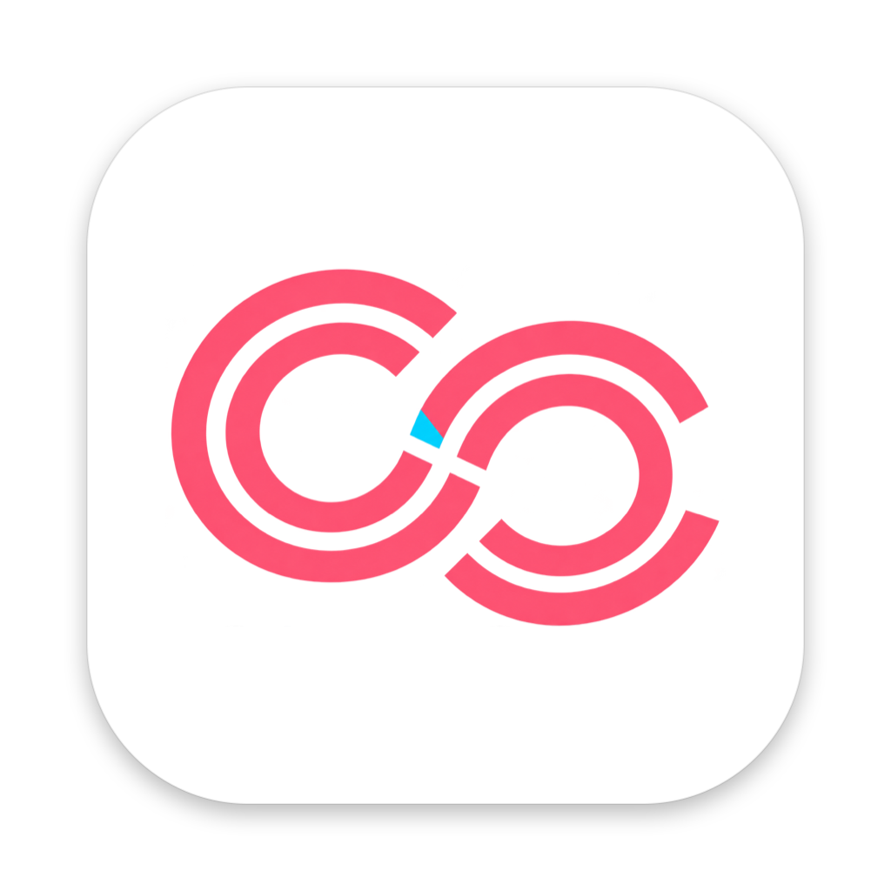

English | [日本語](README.md)

<p align="center"></p>

# ClingCling

An intent-aware clipboard for macOS: it understands what you copied and suggests what to do next.
**Privacy First / Local First** — every check runs on your Mac, and ClingCling itself makes no network connections. Only content that passes the local checks can be handed to an AI (the Claude or ChatGPT app or website), and only when you explicitly ask. The checks have limits (see [Privacy behavior](#privacy-behavior)). No API key is needed.

ClingCling is built Japanese-first. The UI is available in Japanese and English and follows your macOS language by default.

## Requirements

- macOS 14 or later
- To build from source: the macOS 26 SDK or later (Xcode or the Command Line Tools)

## Install

Versions on [Releases](https://github.com/mori-ri/ClingCling/releases/latest) are signed with a Developer ID and notarized by Apple. Unzip the download, move `ClingCling.app` to `/Applications`, and open it.

To build from source:

```sh
git clone https://github.com/mori-ri/ClingCling.git
cd ClingCling
scripts/create-signing-cert.sh   # optional, recommended: keeps the Accessibility permission across rebuilds
./scripts/bundle.sh              # creates build/ClingCling.app (no Xcode needed, Command Line Tools are enough)
open build/ClingCling.app
```

Without a signing certificate the app is ad-hoc signed, and you need to grant the Accessibility permission again after every build (`tccutil reset Accessibility io.github.mori-ri.clingcling`).

## Usage

- ClingCling stays in the menu bar. Copying shows no notification.
- **⌘⇧V** (change it in Settings › General) opens the popup next to the text cursor. Where the cursor position isn't available it opens at the mouse. Finding the cursor needs the Accessibility permission.
  - Type to filter (case, full/half width and hiragana/katakana are ignored; spaces mean AND) / `↑↓` select / `↩` or click to paste / `1–9` paste the nth item (when the search field is empty)
  - `→` action menu / `⌘1–3` Smart Actions / `⌘4–9` your own AI Actions / `⌘S` save to Downloads / `⌘P` pin / `⌘⌫` delete / `esc` close
- **Save as a file**: "Save to Downloads" in the action menu, or `⌘S`, writes the selected item to Downloads and shows it in Finder (text as UTF-8 `.txt`, JSON as `.json`, images as `.png`, named "ClingCling <copy date and time>"). Temporary items that never reach the disk (passwords, API keys, verification codes) can't be saved.
- **Hover over a row** to see the full text in a card, along with when and in which app you copied it. Long text scrolls inside the card (up to the first 20,000 characters). Secrets stay masked, as in the list.
- **Images** (screenshots, images copied from Preview or the web) stay in the history too, with thumbnails and a larger preview on hover. `↩` pastes the image; "Save to Downloads" writes a PNG.
  - A copy that also carries text (such as spreadsheet cells) is treated as text. File copies from Finder are not captured.
- AI Actions (explain, polish, shorten, translate) are turned on in Settings › AI. ClingCling never calls an API; it hands your instruction and the text to an AI.
  - **App** (default: the Claude and ChatGPT apps): brings the app forward, opens a new chat with ⌘N and pastes (optionally sends with ↩), then restores the clipboard. Needs the Accessibility permission.
  - **URL** (default: `https://claude.ai/new?q={prompt}` / `https://chatgpt.com/?q={prompt}`): opens a URL with `{prompt}` (instruction + text), `{instruction}` or `{text}` filled in. URLs over 8,000 characters are not sent. The text is part of the URL, so it also stays in your browser history.
  - Add or edit destinations and instructions in Settings › AI. On the confirmation screen, `⇥` switches the destination.
  - **Custom Actions**: register a name and an instruction (and optionally a destination) in Settings › AI, and they appear at the end of the action menu.
- Choose the display language in Settings › General (applies after a restart).
- Send feedback to GitHub Discussions from the Settings sidebar or the menu bar.

The icons are generated from the logo:

```sh
swift scripts/make-icons.swift Resources/Branding/ClingCling-logo.png Resources/Generated
```

For development:

```sh
scripts/test.sh                            # Core logic tests
swift scripts/check-localization.swift .   # find missing and unused English strings
swift build && .build/debug/ClingCling
CLINGCLING_SNAPSHOT=/tmp/p.png .build/debug/ClingCling   # write the popup to a PNG (DEBUG only)
```

## Structure

| Module | Role |
|---|---|
| `ClingClingCore/PrivacyGate` | The first local check: pasteboard markers → source app → secret detection → classification → whether the item may leave the Mac (allowlist, fail closed) → retention |
| `ClingClingCore/SecretDetector` | Regular expressions for known secrets, credit cards (Luhn), high-entropy strings, personal information |
| `ClingClingCore/ContentClassifier` | Rule-based classification (text / url / code / command / error / email / address / json / credential / verification_code / other) |
| `ClingClingCore/ActionRanker` | Builds candidates from the type and source app, and ranks up to three using local usage statistics |
| `ClingClingCore/ClipStore` | SQLite (`~/Library/Application Support/ClingCling`, 0600). Image files are `images/<hash>.png` in the same place (0600, removed with their row). Deduplication, retention, action statistics |
| `ClingCling/*` | Menu bar, clipboard monitoring, global shortcut (Carbon HotKey), popup, action execution, AI handoff (`AIHandoff`), settings |

## Privacy behavior

| Input | Handling |
|---|---|
| Concealed / transient markers, password managers, Never Capture apps | Not captured |
| Known secrets (API keys, JWTs, private keys, connection strings, card numbers…), verification codes | **Never written to disk**; kept in memory for 5 minutes, masked in the list and the card, cannot be sent out |
| High-entropy strings (unknown tokens, long hex) | Saved but local only. Only the matching part is masked in the list and the card (URL paths, file paths and CamelCase words don't count as tokens) |
| Personal information (email addresses, phone numbers), addresses, Local Only apps, unclassifiable content | Saved but local only |
| Images | Their content can't be inspected, so they are saved but always local only (markers, password managers and per-app policies apply as for text) |
| Other text / url / code / command / error / json | AI / Search are offered only on your explicit action (with a confirmation first) |

The history folder (`~/Library/Application Support/ClingCling`) is excluded from Time Machine. Backups made before the exclusion keep what they contain.

### Limits of the checks

- Secret and personal-information detection is best effort, based on rules and entropy. A password in no recognizable form, or personal information such as a name, can't be detected: it is saved as ordinary text and can be handed to an AI. Check the content on the AI confirmation screen.
- The "source app" is the frontmost app when the copy is noticed (checked every 0.4 seconds). A copy from a background app, or switching apps right after copying, can be attributed to another app. Password manager exclusion and per-app policies rely on this.
- Links other than web pages (such as `file:` and `vscode:`) ask before opening, and Run asks before running. Don't confirm either for content you don't remember copying.

## Out of scope for MVP v0.1 / known limits

- Text and images only (no files). Images up to 30 MB; they count toward the history limit and retention period.
- The default ⌘⇧V overrides "Paste and Match Style" in many apps (change it in Settings › General).
- The history database is not encrypted (file permission 0600 only).
- Copy Session, Semantic Search and local LLM classification are not implemented.

## License

The source code is under the [MIT License](LICENSE).

The app icon and logo (`Resources/Branding/`, `Resources/Generated/`) are not covered by the MIT License. You may use them to build or introduce ClingCling, but please replace them with your own icon when you distribute a fork or derivative.
