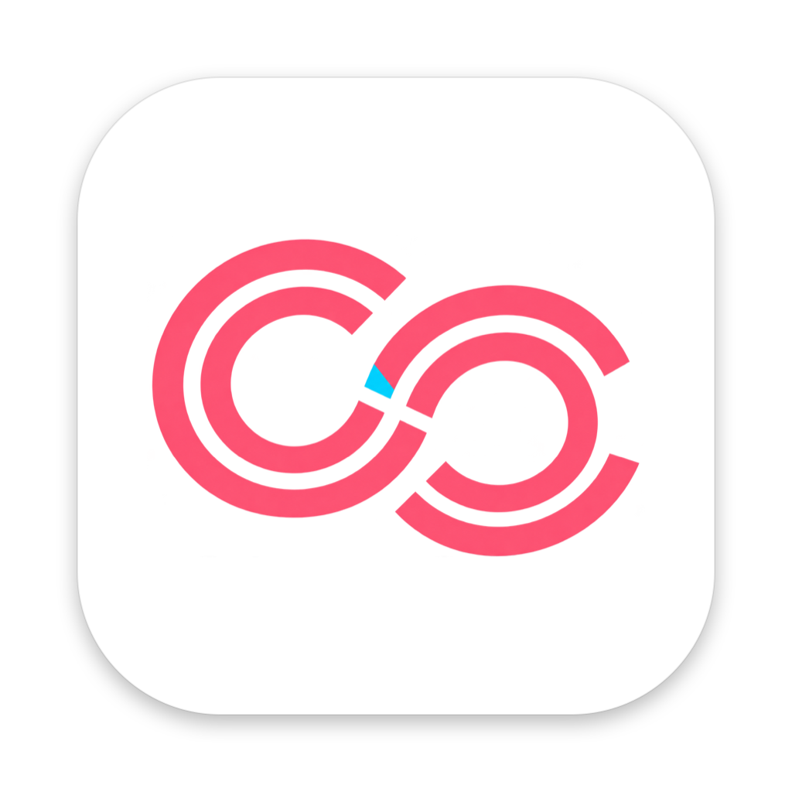

[English](README.en.md) | 日本語

<p align="center"></p>

# ClingCling

コピーした内容を理解して、次の操作を提案する macOS 用クリップボード（Intent-Aware Clipboard）。
**Privacy First / Local First** — 判定はすべて Mac の中で行い、ClingCling 自身は許可なく通信しません（通信するのは、許可したときの新しいバージョンの確認だけです）。ローカルの判定で問題が見つからなかったものだけを、ユーザーの明示操作時に限って AI（Claude / ChatGPT のアプリや Web）に渡します。判定には限界があります（[Privacy の振る舞い](#privacy-の振る舞い)）。API キーは不要です。

## 必要なもの

- macOS 14 以降
- ソースからビルドする場合: macOS 26 以降の SDK（Xcode、または Command Line Tools）

## インストール

[Releases](https://github.com/mori-ri/ClingCling/releases/latest) で公開している版は、Developer ID で署名し、Apple の公証を受けています。zip を展開し、`ClingCling.app` を `/Applications` に移動して開きます。

ソースからビルドする場合:

```sh
git clone https://github.com/mori-ri/ClingCling.git
cd ClingCling
scripts/create-signing-cert.sh   # 任意・推奨（再ビルドしてもアクセシビリティ権限が残る）
./scripts/bundle.sh              # build/ClingCling.app を作成（Xcode 不要、Command Line Tools のみで可）
open build/ClingCling.app
```

署名用の証明書がないと ad-hoc 署名になり、ビルドのたびにアクセシビリティ権限を許可し直す必要があります（`tccutil reset Accessibility io.github.mori-ri.clingcling`）。

## 使い方

- メニューバーに常駐。コピーしても通知は出ません。
- **⌘⇧V**（設定 › 一般 で変更可）でテキストカーソルの横にポップアップを開く（カーソル位置が取れないアプリではマウスの位置。位置の取得にはアクセシビリティ権限が必要）
  - 入力するとそのまま絞り込み（日本語入力の変換中は `↩` `↑↓` `esc` を IME に渡す。大文字小文字・全角半角・ひらがな/カタカナの違いは無視、空白区切りで AND 検索）/ `↑↓` 選択 / `↩`・クリックで貼り付け / `1–9` 履歴の n 番を貼り付け（検索語が空のとき）
  - `→` アクションメニュー / `⌘1–3` 各 Smart Action / `⌘4–9` 自作の AI Action / `⌘S` ダウンロードに保存 / `⌘P` Pin / `⌘⌫` 削除 / `esc` 閉じる
- **ファイルに保存**: アクションメニューの「ダウンロードに保存」か `⌘S` で、選んだ Item を「ダウンロード」に書き出して Finder で示す（テキストは UTF-8 の `.txt`、JSON は `.json`、画像は `.png`。名前は「ClingCling <コピーした日時>」）。ディスクに書かない一時 Item（パスワード・API キー・認証コード）は保存できない
- **行にマウスを載せる**と、横のカードに全文と、いつ・どのアプリでコピーしたかが出る。長い本文はカードの上でスクロールできる（表示は先頭 20,000 文字まで）。Secret は一覧と同じくマスクされたまま
- **画像**（スクリーンショット、プレビューや Web からの画像コピー）も履歴に残る。行にサムネイル、行にマウスを載せると横に拡大プレビュー、`→` のアクションメニューにも大きめのプレビュー。`↩` で画像として貼り付け、「ダウンロードに保存」で PNG を書き出し
  - 取り込むときに macOS の Vision で**写っている文字を読み取る**（OCR。日本語と英語、処理はすべて Mac の中）。読み取った文字は一覧の行とプレビューに出て、検索でも見つかる。アクションメニューの「テキストで貼り付け」で、画像の代わりに文字を貼り付け
  - テキストも一緒に載っているコピー（表計算のセルなど）はテキストとして扱う
- **ファイル**（Finder などでのファイル・フォルダのコピー）も履歴に残る。残すのはパスだけで、ファイルの中身は読まず、複製もしない。行には種類のアイコンと名前（複数なら「a.pdf ほか 2 件」）。画像のファイルは、マウスを載せると横に拡大プレビュー。`↩` でファイルとして貼り付け（Finder ならファイルのコピー、メールなどなら添付）
  - 種類に合わせて Smart Action が変わる:

    | 種類 | Smart Action（既定の順） |
    |---|---|
    | フォルダ | Finder で開く / Terminal で開く / パスをコピー |
    | テキスト・コード（1 つ） | 中身をテキストでコピー / 既定のアプリで開く（「プレビューで開く」など） / Finder で表示 |
    | スクリプト（`.command`、`.sh` など） | 中身をテキストでコピー / Finder で表示 / パスをコピー |
    | アプリ | 起動する / Finder で表示 / パスをコピー |
    | 圧縮ファイル・ディスクイメージ・インストーラ | 展開する・マウントする・インストーラを開く / Finder で表示 / パスをコピー |
    | 画像・PDF・書類など、複数のファイル | 開く / Finder で表示 / パスをコピー |

  - アプリ・インストーラ・スクリプトを開く前と、11 個以上のファイルをまとめて開く前に確認する。中身のコピーは 1 MB までの UTF-8 のテキスト
  - 移動・削除したファイルは、パスのコピー以外の操作ができない（理由を表示）
- AI Action（説明する / 文章を整える / 短くする / 翻訳する）は Settings → AI で有効化。API は直接呼ばず、指示文を付けた本文を AI に渡します。
  - **アプリ**（既定: Claude アプリ / ChatGPT アプリ）: アプリを前面に出し、⌘N で新しいチャットを開いて貼り付け（任意で ↩ 送信）。終わったらクリップボードを元に戻す。アクセシビリティ権限が必要
  - **URL**（既定: `https://claude.ai/new?q={prompt}` / `https://chatgpt.com/?q={prompt}`）: `{prompt}`（指示 + 本文）/ `{instruction}` / `{text}` を埋め込んで開く。8,000 文字を超える URL は送らない。本文が URL に入るので、ブラウザの履歴にも残る
  - 送り先の追加・編集、指示文の編集は Settings → AI。確認画面では `⇥` で送り先を切り替え
  - **自作の Action**: Settings → AI で「名前 + 指示文（+ 送り先）」を登録すると、アクションメニューの末尾に並ぶ（例: 「3 行で要約」「敬語に直す」）

- 表示言語は日本語と英語に対応。既定では macOS の言語に合わせ、設定 › 一般 で選べます（再起動で反映）
- **新しいバージョンのお知らせ**: 既定ではオフで、2 回目の起動時に一度だけ「新しいバージョンを自動で確認しますか？」と聞きます。許可すると、起動時と 1 日 1 回 GitHub にリリースの一覧を問い合わせ、新しいバージョンが出たらメニューバーと設定のサイドバーでお知らせします（ダウンロードはボタンから。自動ではインストールしません）。各バージョンの新機能は 設定 › お知らせ で確認できます。設定 › 一般 でいつでも切り替えられます
- 感想や要望は、設定のサイドバーかメニューバーの「フィードバック・要望」から GitHub Discussions へ送れます

アイコンはロゴから生成します（ロゴを差し替えたら再実行）:

```sh
swift scripts/make-icons.swift Resources/Branding/ClingCling-logo.png Resources/Generated
```

開発時:

```sh
scripts/test.sh              # Core ロジックのテスト
swift scripts/check-localization.swift .   # 英訳の抜けと、使われていない英訳を検出
swift build && .build/debug/ClingCling
CLINGCLING_SNAPSHOT=/tmp/p.png .build/debug/ClingCling   # ポップアップを PNG に書き出す（DEBUG のみ）
```

## 構成

| モジュール | 役割 |
|---|---|
| `ClingClingCore/PrivacyGate` | 最前段のローカル判定。Pasteboard marker → コピー元アプリ → Secret 検出 → 分類 → 外部送信可否（許可リスト方式・Fail Closed）→ Retention |
| `ClingClingCore/SecretDetector` | 既知 Secret の正規表現、クレジットカード（Luhn）、高エントロピー文字列、個人情報 |
| `ClingClingCore/ContentClassifier` | ルールベース分類（text / url / code / command / error / email / address / json / credential / verification_code / other） |
| `ClingClingCore/FileKind` | コピーしたファイルの種類（拡張子とフォルダかどうかだけで判定。中身は読まない） |
| `ClingClingCore/ActionRanker` | 分類＋コピー元アプリで候補を作り、ローカル利用統計で並べ替えて最大 3 つ |
| `ClingClingCore/ClipStore` | SQLite（`~/Library/Application Support/ClingCling`、0600）。画像本体は同じ場所の `images/<hash>.png`（0600、行が消えるとファイルも削除）、読み取った文字は DB。重複排除、保存期間、Action 統計、First Action Selection Rate |
| `ClingClingCore/UpdateChecker`・`ReleaseNotes` | 新しいバージョンの確認（GitHub のリリース一覧）と、お知らせのページに出すリリースノートの整形 |
| `ClingCling/*` | メニューバー、Clipboard 監視、画像の文字の読み取り（`TextRecognizer`、Vision）、⌘⇧V（Carbon HotKey）、ポップアップ、Action 実行、AI への受け渡し（`AIHandoff`）、設定、お知らせ |

## Privacy の振る舞い

| 入力 | 扱い |
|---|---|
| Concealed / Transient marker、Password Manager、Never Capture アプリ | キャプチャしない |
| 既知 Secret（API キー、JWT、秘密鍵、接続文字列、カード番号…）、認証コード | **ディスクに書かず**メモリで 5 分保持、一覧とカードではマスク（認証コードは読めるようそのまま表示）、外部送信不可 |
| 高エントロピー文字列（未知 Token・長い Hex） | 保存するが Local only。一覧とカードでは該当部分だけをマスク（URL のパスやファイルパス、CamelCase の語は Token とみなさない） |
| 個人情報（メール・電話番号）、住所、Local Only アプリ、分類不能 | 保存するが Local only |
| 画像 | 写っている文字（OCR）をテキストと同じく Secret 検出にかける。Secret や認証コードが写っていれば、画像もディスクに書かずメモリで 5 分保持。文字以外の中身や読み違いまでは検査できないので、常に Local only（marker・Password Manager・アプリ単位のポリシーはテキストと同じく適用） |
| ファイル | パスだけを保存し、中身は読まない（「中身をテキストでコピー」を選んだときだけ読む）。常に Local only（marker・Password Manager・アプリ単位のポリシーはテキストと同じく適用） |
| それ以外の text / url / code / command / error / json | 明示操作時のみ AI / Search を提示（渡す前に確認） |

ClingCling が自分から通信するのは、新しいバージョンの確認（起動時と 1 日 1 回、`api.github.com` にリリースの一覧を問い合わせる）だけで、既定ではオフです。2 回目の起動時に一度だけ聞き、許可したときだけ確認します（設定 › 一般 の「新しいバージョンを確認する」でいつでも切り替え可）。オフの間は、お知らせ のページで「読み込む」を押したときだけ問い合わせます。問い合わせにコピーした内容や設定は含めません。

履歴の保存先（`~/Library/Application Support/ClingCling`）は Time Machine のバックアップから除外します。除外する前のバックアップに含まれている分は、バックアップ側に残ります。

### 判定の限界

- Secret と個人情報の検出は、規則とエントロピーによるベストエフォートです。形式に当てはまらないパスワードや、氏名などの個人情報は検出できず、通常の文章として保存され、AI にも渡せます。AI の確認画面で内容を確かめてください
- 「コピー元アプリ」は、コピーを検知したとき（0.4 秒ごとの確認）に最前面にあるアプリです。バックグラウンドのアプリからのコピーや、コピー直後にアプリを切り替えた場合は、別のアプリとして判定されることがあります。Password Manager の除外とアプリ単位のポリシーも、この判定に従います
- Web ページ以外のリンク（`file:` や `vscode:` など）は、開く前に確認します。Run も実行前に確認します。どちらも、自分でコピーした覚えのない内容は実行しないでください

## MVP v0.1 の範囲外 / 既知の制限

- テキスト・画像・ファイルが対象。画像は 30 MB まで、ファイルは一度に 200 個まで。件数は履歴の上限・保存期間に含まれる
- ファイルは参照（パス）だけを残すので、元のファイルを移動・削除すると履歴からは開けない
- 既定の ⌘⇧V は、多くのアプリの「スタイルを合わせてペースト」を上書きします（設定 › 一般 で変更できます）
- 履歴 DB は暗号化していない（ファイル権限 0600 のみ）
- Copy Session、Semantic Search、ローカル LLM 分類は未実装

## ライセンス

ソースコードは [MIT License](LICENSE) です。

アプリアイコンとロゴ（`Resources/Branding/`、`Resources/Generated/`）は MIT License の対象外です。ClingCling のビルドや紹介のために使うのは構いませんが、fork や派生物を配布するときは別のアイコンに差し替えてください。
